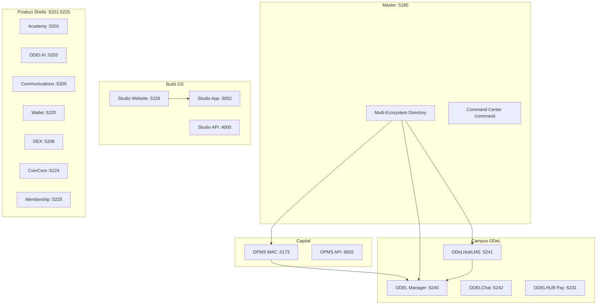

> Historical source snapshot from [infoedutechos/ODEI-Multi-Ecosystem/docs/ecosystem/ODEI_MULTI_ECOSYSTEM_PRODUCT_MAP.md](https://github.com/infoedutechos/ODEI-Multi-Ecosystem/blob/b9878e8dcc34942ec10fa5fddea34028a5456b42/docs/ecosystem/ODEI_MULTI_ECOSYSTEM_PRODUCT_MAP.md). Imported from source commit `b9878e8dcc34942ec10fa5fddea34028a5456b42`. Credentials and private-key material, if present, have been redacted. This is historical reference material, not evidence of target implementation.

---

# ODEI Multi-Ecosystem — Complete Product Map

**Updated:** 2026-09-03  
**Machine registry:** [`apps/ecosystem-registry.json`](../../apps/ecosystem-registry.json)  
**Ports & domains:** [`PRODUCT_PORTS_AND_DOMAINS.md`](./PRODUCT_PORTS_AND_DOMAINS.md)  
**Live URLs:** [`PRODUCT_URLS_LIVE_STATUS.md`](./PRODUCT_URLS_LIVE_STATUS.md)  
**Logins:** [`../ops/LOCAL_LOGINS_AND_USERS.md`](../ops/LOCAL_LOGINS_AND_USERS.md)

---

## Architecture layers



---

## All products (local ports)

| ID | Product | Port | Local URL | Folder |
|----|---------|-----:|-----------|--------|
| `multi-ecosystem` | ODEI Multi-Ecosystem (master) | 5180 | http://localhost:5180/ | `apps/` shells |
| `opms` | OPMS (MAC) | 5173 | http://localhost:5173/admin | `ODEI Pre-Sale Management System (OPMS)/` |
| `api` | OPMS API | 8002 | http://127.0.0.1:8002/ | OPMS `backend/` |
| `docs` | Docs library | 8765 | http://localhost:8765/docs/ | `docs/` |
| `academy` | ODEI Academy | 5201 | http://localhost:5201/ | `apps/academy/` |
| `cloud` | ODEI Cloud | 5202 | http://localhost:5202/ | `apps/cloud/` |
| `ai` | ODEI AI | 5203 | http://localhost:5203/ | `apps/ai/` |
| `chain` | ODEI Chain OS | 5204 | http://localhost:5204/ | `apps/chain/` |
| `communications` | ODEI Communications (OMSG) | 5205 | http://localhost:5205/ | `apps/communications/` |
| `core` | ODEI Core | 5206 | http://localhost:5206/ | `apps/core/` |
| `defi` | ODEI DeFi | 5207 | http://localhost:5207/ | `apps/defi/` |
| `dex` | ODEI DEX | 5208 | http://localhost:5208/app/ | `apps/dex/` |
| `earn` | ODEI Earn | 5209 | http://localhost:5209/ | `apps/earn/` |
| `exchange` | ODEI Exchange | 5210 | http://localhost:5210/ | `apps/exchange/` |
| `foundation` | ODEI Foundation | 5211 | http://localhost:5211/ | `apps/foundation/` |
| `launchpad` | ODEI Launchpad | 5212 | http://localhost:5212/ | `apps/launchpad/` |
| `marketplace` | ODEI Marketplace | 5213 | http://localhost:5213/ | `apps/marketplace/` |
| `merchant` | ODEI Merchant Platform | 5214 | http://localhost:5214/ | `apps/merchant/` |
| `pay` | ODEI Pay | 5215 | http://localhost:5215/ | `apps/pay/` |
| `store` | ODEI Store | 5216 | http://localhost:5216/ | `apps/store/` |
| `switch` | ODEI Switch | 5217 | http://localhost:5217/ | `apps/switch/` |
| `tokens` | ODEI Tokens | 5218 | http://localhost:5218/ | `apps/tokens/` |
| `treasury` | ODEI Treasury | 5219 | http://localhost:5219/ | `apps/treasury/` |
| `wallet` | ODEI Wallet | 5220 | http://localhost:5220/app/ | `apps/wallet/` |
| `odel-hub` | ODEL Hub | 5221 | http://localhost:5221/ | `apps/odel-hub/` |
| `identity` | ODEI Identity | 5222 | http://localhost:5222/ | `apps/identity/` |
| `dicei` | DiCEI Africa | 5223 | http://localhost:5223/ | `apps/dicei/` |
| `coincore` | CoinCore by ODEIAfrica | 5224 | http://localhost:5224/app/ | `apps/coincore/` |
| `membership` | ODEI Membership | 5225 | http://localhost:5225/app/ | `apps/membership/` |
| `studio` | ODEI Studio (website) | 5226 | http://localhost:5226/ | `ODEI Studio/` |
| `studio-app` | ODEI Studio App | 3002 | http://localhost:3002/app | `ODEI Studio/` |
| `studio-api` | ODEI Studio API | 4000 | http://localhost:4000/health | `ODEI Studio/` |
| `studio-path-bridge` | Absolute Path Companion | 4010 | http://localhost:4010/health | `ODEI Studio/` |
| `odelhub-pay` | ODELHUB Pay | 5231 | http://localhost:5231/ | `apps/odelhub-pay/` |
| `odel-manager` | ODEL Manager | 5240 | http://localhost:5240/app/ | `apps/odel-manager/` |
| `odel-lms` | ODeLHubLMS | 5241 | http://localhost:5241/ | `apps/odel-lms/` |
| `odel-chat` | ODELChat | 5242 | http://localhost:5242/ | `apps/odel-chat/` |
| `online-banking` | OnlineBanking (partner) | 5243 | http://localhost:5243/ | `apps/online-banking/` |
| `online-banking-laravel` | OnlineBanking Laravel | 5244 | http://localhost:5244/ | `apps/online-banking-laravel/` |
| `assessmentverse` | AssessmentVerse OS (Flask) | 5001 | http://127.0.0.1:5001/ | `AssessmentVerseOS/` |

---

## Campus cluster (TU / ODeL)

| Flow | LMS (:5241) | Manager (:5240) |
|------|-------------|-----------------|
| New application | `#/apply/team-university` | `#/admission` → Import from LMS |
| Semester registration | `#/register/team-university/biodata` | `#/admission` → Semester Registration |
| ERMS exams | — | `#/erms/` |
| Office memos | (future banner) | `#/admission` → Office Memos |
| Documents | `#/documents` | `#/documents` |

---

## Run commands (root)

```powershell
cd "E:\ODEI Multi Ecosystem"
npm run dev                    # all product shells + AI + docs + Studio spawns
npm run dev:all                # + OPMS UI :5173 + API :8002
npm run dev:opms               # OPMS MAC only
npm run dev:opms-api           # OPMS FastAPI only
npm run dev:studio             # Studio App :3002
npm run dev:studio-all         # Studio App + API + path-bridge
npm run smoke:manager          # ODEL Manager smoke
npm run verify:opms            # OPMS MAC + API probe
npm run verify:manager         # :5240/app + LMS API
npm run docs:build             # rebuild docs library
npm run help                   # full script list
```

**OPMS login:** `admin@odei.local` / `admin123` (requires `:8002`, or dev local_sim bypass when API offline).  
**OPMS MAC chrome:** `OPMS · OS-like · Multi-tab · Operator surface` — not ODEL Manager.  
**ODEL Manager MAC chrome:** `ODEL Manager · OS-like · Multi-tab · Operator surface`.  
Full logins: [`../ops/LOCAL_LOGINS_AND_USERS.md`](../ops/LOCAL_LOGINS_AND_USERS.md)

---

## Related docs

- [`../campus/LMS_MANAGER_INTEGRATION.md`](../campus/LMS_MANAGER_INTEGRATION.md)
- [`../campus/TU_SEMESTER_REGISTRATION.md`](../campus/TU_SEMESTER_REGISTRATION.md)
- [`../ops/HOW_TO_RUN_LOCAL.md`](../ops/HOW_TO_RUN_LOCAL.md)
