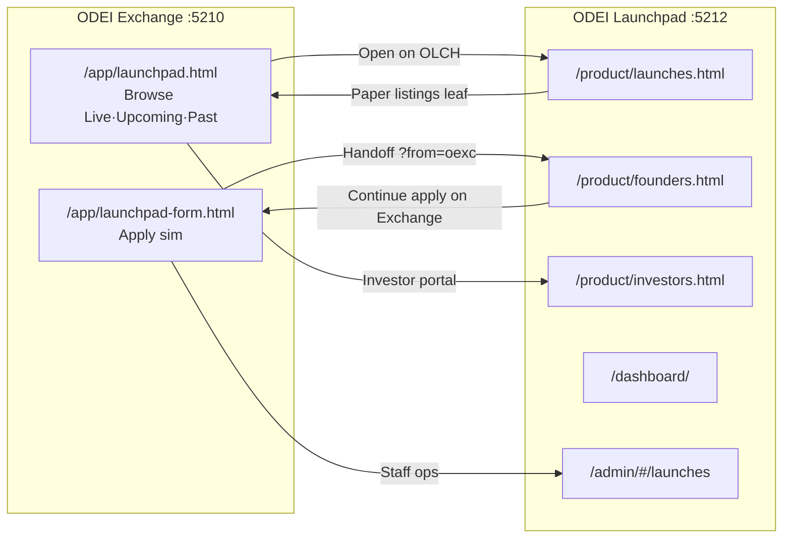

> Historical source snapshot from [infoedutechos/ODEI-Multi-Ecosystem/docs/ecosystem/ODEI_OEXC_OLCH_INTEGRATION.md](https://github.com/infoedutechos/ODEI-Multi-Ecosystem/blob/b9878e8dcc34942ec10fa5fddea34028a5456b42/docs/ecosystem/ODEI_OEXC_OLCH_INTEGRATION.md). Imported from source commit `b9878e8dcc34942ec10fa5fddea34028a5456b42`. Credentials and private-key material, if present, have been redacted. This is historical reference material, not evidence of target implementation.

---

# OEXC ↔ OLCH Integration Map

**Updated:** 2026-07-25  
**Products:** ODEI Exchange (`:5210`, **OEXC**) · ODEI Launchpad (`:5212`, **OLCH**)  
**Design rule:** Do **not** restyle either product. Exchange keeps Barlow / `#0c1218` / `#22d3ee`. Launchpad keeps Teko + DM Sans / `#100818` / `#fb7185` · `#fbbf24`.

---

## Roles (who owns what)

| Concern | Owner | Surface |
|---------|-------|---------|
| Custodial browse of paper listings (CEX leaf) | **OEXC** | http://localhost:5210/app/launchpad.html |
| Apply form (sim intake on Exchange) | **OEXC** | http://localhost:5210/app/launchpad-form.html |
| Capital formation product / IDR / investors / founders | **OLCH** | http://localhost:5212/product/* |
| Live raise truth (campaigns, vesting, DD) | **OLCH** (future extract) | Marketing + MAC `#/launches` today |
| Operator launch ops | **OLCH MAC** | http://localhost:5212/admin/#/launches |

**Honesty:** Exchange listings/applications are **paper/sim**. OLCH product pages are **IA marketing stubs** until capital extract lands. Neither claims live IDO.

---

## Architecture (recommended)

**Do not:** iframe OLCH inside Exchange (two design systems).  
**Do not:** merge `odei_exchange_oexc_v*` into Launchpad storage.  
**Do:** deep-link + optional Identity SSO later.

---

## Phase plan

### Phase 1 — Deep-link fabric (now)

- Exchange Launchpad CTAs → specific OLCH paths (not only root)
- OLCH Launches / Founders / footer → Exchange paper leaf
- Shared peer map: `apps/exchange/app/olch-peers.json`
- Dashboard modules on both sides
- Form success: sim saved locally **and** handoff link to OLCH Founders / MAC

### Phase 2 — Auth continuity

- Identity `:5222` SSO so `exchange` ↔ `launchpad` sessions do not re-login
- Preserve product-scoped roles; staff still land on each product's MAC

### Phase 3 — Catalog sync

- OLCH publishes read-only `catalog.json` (or MAC `#/launches` API)
- Exchange `bindLaunchpad` hydrates from peer when available; falls back to local sim seed
- Per-card “Open on OLCH” uses project slug

### Phase 4 — Live capital

- Apply posts to OLCH intake (not only Exchange localStorage)
- Exchange becomes discovery + custody listing leaf; OLCH remains capital truth

---

## Peer URL map

| Intent | URL |
|--------|-----|
| OLCH home | http://localhost:5212/ |
| Launches (capital) | http://localhost:5212/product/launches.html |
| Founders | http://localhost:5212/product/founders.html |
| Investors | http://localhost:5212/product/investors.html |
| IDR | http://localhost:5212/product/idr.html |
| Member dashboard | http://localhost:5212/dashboard/ |
| MAC launches | http://localhost:5212/admin/#/launches |
| OEXC paper Launchpad | http://localhost:5210/app/launchpad.html |
| OEXC apply | http://localhost:5210/app/launchpad-form.html |
| OEXC listings stub | http://localhost:5210/app/listings.html |

Canonical JSON: [`apps/exchange/app/olch-peers.json`](../apps/exchange/app/olch-peers.json)

---

## Change log

| Date | Change |
|------|--------|
| 2026-07-25 | Investigation + Phase 1 deep-link fabric |
